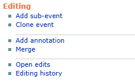
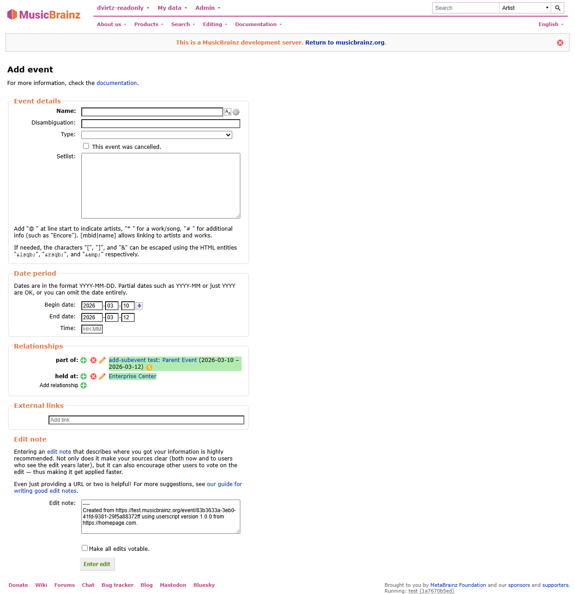
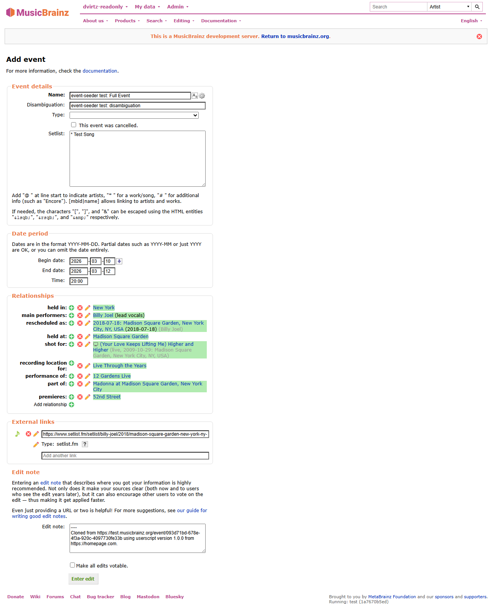
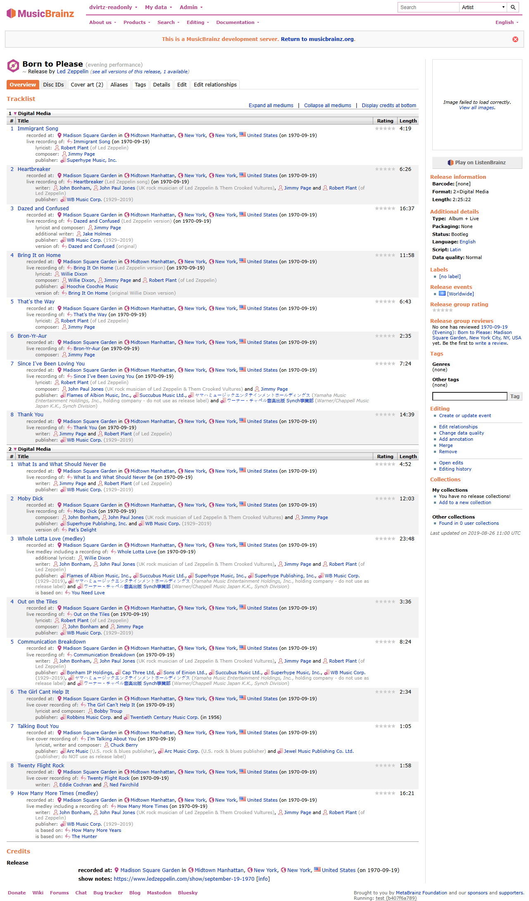
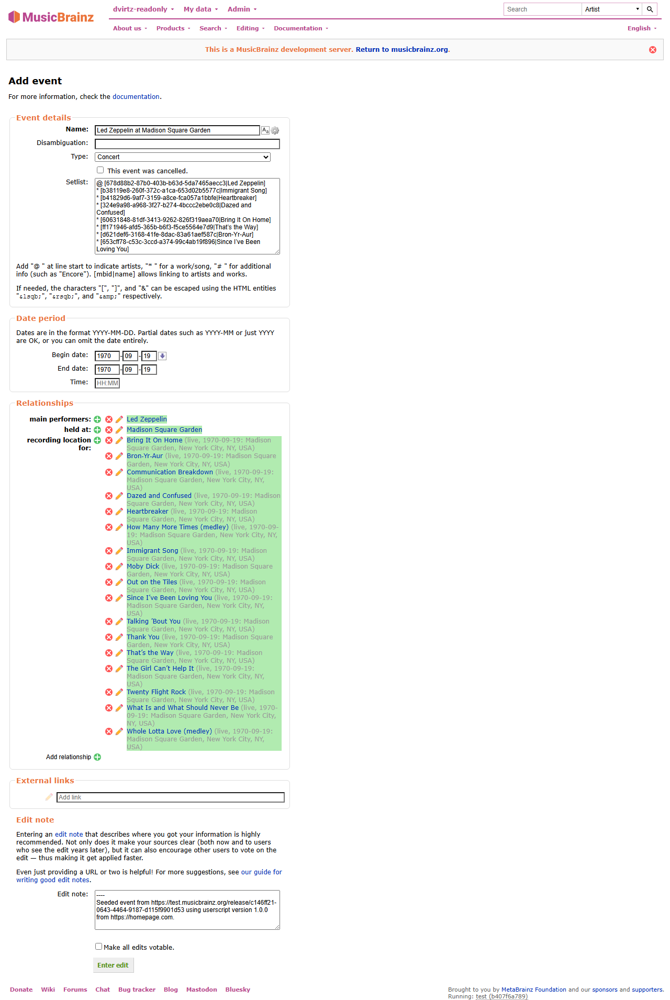

# Event Seeder

[![install][badge-install]](https://github.com/dvirtz/musicbrainz-scripts/releases/latest/download/event-seeder.user.js) [![beta][badge-beta]](https://github.com/dvirtz/musicbrainz-scripts/releases/download/beta-latest/event-seeder.user.js) [![source][badge-source]](src/index.ts)

Seeds child events, clones events, and creates or updates events from series and live releases.

## What it does

- Runs on MusicBrainz event, series and release pages.
- On event series, adds an `Add event` link. On live releases, adds a `Create or update event` link.
- Adds `Add sub-event` and `Clone event` links in the Editing sidebar.
- `Add sub-event` opens `event/create` with fields prefilled from the current event as a parent:
  - Begin/end dates
  - `part of` relationship to the parent event
  - `held at` relationships for linked places on the parent event
- `Clone event` opens `event/create` with the current event's editable fields prefilled:
  - Name, dates, time, setlist, and disambiguation
  - Entity and URL relationships copied from the current event
  - A generated edit note that links back to the source event

## Notes

- If no linked places are found, only dates and the parent relationship are seeded.
- If a date is partial, only available date components are seeded.
- Clone seeding intentionally preserves existing event data instead of creating a parent/child relationship.

## Workflow

1. Open an event page.
2. Click `Add sub-event` to seed a child event with dates and place from the current event.

    

3. Click `Clone event` to open a fully seeded copy of the current event in `event/create`.

    

## Live releases

### Usage

1. Open a live release overview page on MusicBrainz while logged in.
2. Click **Create or update event** under **Editing** in the sidebar.
3. Review the populated event editor and submit the edit yourself. Open the link in a new tab using your browser if preferred.

The script prefers one event linked directly to the release with a **recorded at** relationship. Otherwise, it updates a single event shared by every distinct recording. If none is shared, it seeds a new concert. Repeated recordings receive one relationship but retain each appearance in the setlist.

The release group must have the **Live** secondary type. The action is hidden for studio releases and releases without that classification, even if their titles mention live performances. Live compilations are eligible; conflicting source dates or venues still stop the import.

### Imported data

| Source | Event data |
| --- | --- |
| Recording places and areas | Held at / held in relationships |
| Recording and performance relationship dates | Begin and end dates, preserving partial dates |
| Track artist credits and performance relationships | Main performers, guests, orchestras and conductors |
| Release and recording artist relationships whose type name contains "engineer" | Event engineers |
| Distinct recordings | Recording location relationships |
| Tracklist and linked performance works | Setlist in medium/track order, with artist credits and ordered medley works |

The setlist uses track titles when works are unavailable. Applicable credited names and attributes supported by the destination relationship are retained. Artist relationships mentioning "engineer" in their type name are mapped to event engineers. Publication dates and post-production dates are not used as event dates. Production and artwork credits are excluded, as are special-purpose artists such as Various Artists.

New concerts use **Artist at Venue** as their name, falling back to the release title when no venue is known. Existing event names and types are not seeded. Dates, setlist and relationships are seeded for native editor review; check any existing content before submitting. The edit note identifies the source release and userscript.

## Release Notes

See [CHANGELOG.md](CHANGELOG.md).

[badge-install]: https://img.shields.io/badge/install-latest-3c9a40?style=for-the-badge&logo=data%3Aimage%2Fsvg%2Bxml%3Bbase64%2CPHN2ZyB4bWxucz0iaHR0cDovL3d3dy53My5vcmcvMjAwMC9zdmciIHhtbG5zOnhsaW5rPSJodHRwOi8vd3d3LnczLm9yZy8xOTk5L3hsaW5rIiB2ZXJzaW9uPSIxLjEiIGlkPSJDYXBhXzEiIHg9IjBweCIgeT0iMHB4IiB2aWV3Qm94PSIwIDAgMjkuOTc4IDI5Ljk3OCIgc3R5bGU9ImN1cnNvcjogZGVmYXVsdDsiIHhtbDpzcGFjZT0icHJlc2VydmUiPiA8Zz4gPHBhdGggc3R5bGU9ImZpbGw6IzNDOUE0MDsiIGQ9Ik0yNS40NjIsMTkuMTA1djYuODQ4SDQuNTE1di02Ljg0OEgwLjQ4OXY4Ljg2MWMwLDEuMTExLDAuOSwyLjAxMiwyLjAxNiwyLjAxMmgyNC45NjdjMS4xMTUsMCwyLjAxNi0wLjksMi4wMTYtMi4wMTIgICB2LTguODYxSDI1LjQ2MnoiLz4gPHBhdGggc3R5bGU9ImZpbGw6IzNDOUE0MDsiIGQ9Ik0xNC42MiwxOC40MjZsLTUuNzY0LTYuOTY1YzAsMC0wLjg3Ny0wLjgyOCwwLjA3NC0wLjgyOHMzLjI0OCwwLDMuMjQ4LDBzMC0wLjU1NywwLTEuNDE2YzAtMi40NDksMC02LjkwNiwwLTguNzIzICAgYzAsMC0wLjEyOS0wLjQ5NCwwLjYxNS0wLjQ5NGMwLjc1LDAsNC4wMzUsMCw0LjU3MiwwYzAuNTM2LDAsMC41MjQsMC40MTYsMC41MjQsMC40MTZjMCwxLjc2MiwwLDYuMzczLDAsOC43NDIgICBjMCwwLjc2OCwwLDEuMjY2LDAsMS4yNjZzMS44NDIsMCwyLjk5OCwwYzEuMTU0LDAsMC4yODUsMC44NjcsMC4yODUsMC44NjdzLTQuOTA0LDYuNTEtNS41ODgsNy4xOTMgICBDMTUuMDkyLDE4Ljk3OSwxNC42MiwxOC40MjYsMTQuNjIsMTguNDI2eiIvPiA8Zz4gPC9nPiA8Zz4gPC9nPiA8Zz4gPC9nPiA8Zz4gPC9nPiA8Zz4gPC9nPiA8Zz4gPC9nPiA8Zz4gPC9nPiA8Zz4gPC9nPiA8Zz4gPC9nPiA8Zz4gPC9nPiA8Zz4gPC9nPiA8Zz4gPC9nPiA8Zz4gPC9nPiA8Zz4gPC9nPiA8Zz4gPC9nPiA8L2c%2BIDxnPiA8L2c%2BIDxnPiA8L2c%2BIDxnPiA8L2c%2BIDxnPiA8L2c%2BIDxnPiA8L2c%2BIDxnPiA8L2c%2BIDxnPiA8L2c%2BIDxnPiA8L2c%2BIDxnPiA8L2c%2BIDxnPiA8L2c%2BIDxnPiA8L2c%2BIDxnPiA8L2c%2BIDxnPiA8L2c%2BIDxnPiA8L2c%2BIDxnPiA8L2c%2BIDwvc3ZnPg%3D%3D&labelColor=lightyellow
[badge-beta]: https://img.shields.io/badge/install-beta-d83a3a?style=for-the-badge&logo=data%3Aimage%2Fsvg%2Bxml%3Bbase64%2CPHN2ZyB4bWxucz0iaHR0cDovL3d3dy53My5vcmcvMjAwMC9zdmciIHhtbG5zOnhsaW5rPSJodHRwOi8vd3d3LnczLm9yZy8xOTk5L3hsaW5rIiB2ZXJzaW9uPSIxLjEiIGlkPSJDYXBhXzEiIHg9IjBweCIgeT0iMHB4IiB2aWV3Qm94PSIwIDAgMjkuOTc4IDI5Ljk3OCIgc3R5bGU9ImN1cnNvcjogZGVmYXVsdDsiIHhtbDpzcGFjZT0icHJlc2VydmUiPiA8Zz4gPHBhdGggc3R5bGU9ImZpbGw6IzNDOUE0MDsiIGQ9Ik0yNS40NjIsMTkuMTA1djYuODQ4SDQuNTE1di02Ljg0OEgwLjQ4OXY4Ljg2MWMwLDEuMTExLDAuOSwyLjAxMiwyLjAxNiwyLjAxMmgyNC45NjdjMS4xMTUsMCwyLjAxNi0wLjksMi4wMTYtMi4wMTIgICB2LTguODYxSDI1LjQ2MnoiLz4gPHBhdGggc3R5bGU9ImZpbGw6IzNDOUE0MDsiIGQ9Ik0xNC42MiwxOC40MjZsLTUuNzY0LTYuOTY1YzAsMC0wLjg3Ny0wLjgyOCwwLjA3NC0wLjgyOHMzLjI0OCwwLDMuMjQ4LDBzMC0wLjU1NywwLTEuNDE2YzAtMi40NDksMC02LjkwNiwwLTguNzIzICAgYzAsMC0wLjEyOS0wLjQ5NCwwLjYxNS0wLjQ5NGMwLjc1LDAsNC4wMzUsMCw0LjU3MiwwYzAuNTM2LDAsMC41MjQsMC40MTYsMC41MjQsMC40MTZjMCwxLjc2MiwwLDYuMzczLDAsOC43NDIgICBjMCwwLjc2OCwwLDEuMjY2LDAsMS4yNjZzMS44NDIsMCwyLjk5OCwwYzEuMTU0LDAsMC4yODUsMC44NjcsMC4yODUsMC44NjdzLTQuOTA0LDYuNTEtNS41ODgsNy4xOTMgICBDMTUuMDkyLDE4Ljk3OSwxNC42MiwxOC40MjYsMTQuNjIsMTguNDI2eiIvPiA8Zz4gPC9nPiA8Zz4gPC9nPiA8Zz4gPC9nPiA8Zz4gPC9nPiA8Zz4gPC9nPiA8Zz4gPC9nPiA8Zz4gPC9nPiA8Zz4gPC9nPiA8Zz4gPC9nPiA8Zz4gPC9nPiA8Zz4gPC9nPiA8Zz4gPC9nPiA8Zz4gPC9nPiA8Zz4gPC9nPiA8Zz4gPC9nPiA8L2c%2BIDxnPiA8L2c%2BIDxnPiA8L2c%2BIDxnPiA8L2c%2BIDxnPiA8L2c%2BIDxnPiA8L2c%2BIDxnPiA8L2c%2BIDxnPiA8L2c%2BIDxnPiA8L2c%2BIDxnPiA8L2c%2BIDxnPiA8L2c%2BIDxnPiA8L2c%2BIDxnPiA8L2c%2BIDxnPiA8L2c%2BIDxnPiA8L2c%2BIDxnPiA8L2c%2BIDwvc3ZnPg%3D%3D&labelColor=lightyellow
[badge-source]: https://img.shields.io/badge/source-lightyellow?style=for-the-badge&logo=data%3Aimage%2Fsvg%2Bxml%3Bbase64%2CPHN2ZyB4bWxucz0iaHR0cDovL3d3dy53My5vcmcvMjAwMC9zdmciIHhtbG5zOnhsaW5rPSJodHRwOi8vd3d3LnczLm9yZy8xOTk5L3hsaW5rIiB2ZXJzaW9uPSIxLjEiIHg9IjBweCIgeT0iMHB4IiB2aWV3Qm94PSIwIDAgMTAwIDEwMCIgZW5hYmxlLWJhY2tncm91bmQ9Im5ldyAwIDAgMTAwIDEwMCIgeG1sOnNwYWNlPSJwcmVzZXJ2ZSIgc3R5bGU9ImN1cnNvcjogZGVmYXVsdDsiPjxwYXRoIHN0eWxlPSJmaWxsOiMzODM4OEE7IiBkPSJNMi4zNDMsNTQuMUMwLjkzOCw1My4xNjIsMCw1MS4yODksMCw0OS42NDhjMC0xLjY0LDAuNzAzLTMuMTYyLDIuNDYtMy45ODJIMi4zNDNjOC4zMTctNC45MiwxOS45MTUtMTEuNDgsMjcuNjQ3LTE2LjA0OSAgdjEwLjg5NWMtMy4wNDYsMS43NTctNy4xNDYsMy43NDktMTcuNDU1LDkuMjU1bDAuMTE3LDAuMTE2YzUuNTA2LDIuNDYxLDExLjgzMiw2LjIwOSwxNy4zMzgsOS40ODl2MTEuMDEyTDIuMzQzLDU0LjF6Ii8%2BPHBhdGggc3R5bGU9ImZpbGw6IzM4Mzg4QTsiIGQ9Ik05Ny42NTcsNDUuOWMxLjQwNCwwLjkzOCwyLjM0MywyLjgxMiwyLjM0Myw0LjQ1MmMwLDEuNjQtMC43MDMsMy4xNjItMi40NjEsMy45ODJoMC4xMTggIGMtOC4zMTcsNC45Mi0xOS45MTYsMTEuNDgtMjcuNjQ3LDE2LjA0OVY1OS40ODhjMy4wNDYtMS43NTYsNy4xNDYtMy43NDgsMTcuNDU1LTkuMjU0bC0wLjExNy0wLjExNiAgYy01LjUwNS0yLjQ2MS0xMS44MzItNi4yMDktMTcuMzM4LTkuNDg5VjI5LjYxN0w5Ny42NTcsNDUuOXoiLz48cGF0aCBzdHlsZT0iZmlsbDojMzgzODhBOyIgZD0iTTQ2LjQwMSw3MS44NDRIMzkuMzlMNTMuNDgsMjguMTU2aDcuMTNMNDYuNDAxLDcxLjg0NHoiLz48L3N2Zz4%3D
